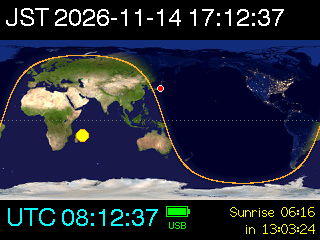
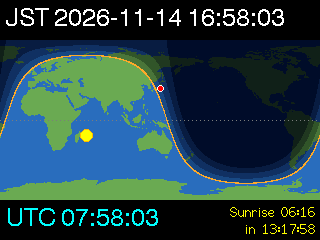

# m5-grayline

[English](README.md) | 日本語

M5Stack 用のグレイラインマップです。世界地図に昼・夜・薄明とグレイライン (日の出・日の入りの境界線) を表示します。時刻は Wi-Fi 経由の NTP で取得します。

| 写真風 (既定) | 薄明の塗り分け | グリッドと月の重ね描き | 詳細画面 |
| --- | --- | --- | --- |
|  |  |  |  |

## 特徴

- 正距円筒図法の世界地図を、自局の経度を中心に表示します。
- 地図は 2 種類から選べます。写真風 (NASA Blue Marble / Earth at Night) と、薄明 (市民・航海・天文) の塗り分けです。
- グレイライン、太陽直下点、自局の位置を表示します。Maidenhead グリッドと月も重ねて表示できます。
- 現地時刻と UTC、次の日の出・日の入りまでのカウントダウンを表示します (極夜・白夜にも対応します)。
- 詳細画面には、薄明・日の出・日の入り・南中の時刻、昼の長さ、太陽の高度と方位、赤緯、均時差、月の輝面比、グリッドロケーターを表示します。
- 自局の位置は `config.json`、GeoIP (ipinfo.io)、東京の順に決めます。
- 夜間やバッテリー動作時は画面を暗くします。Wi-Fi は NTP 同期のときだけ接続します。

ボタン: A は NTP の再同期、B は地図の切り替え (長押しで重ね描きの切り替え)、C は地図と詳細画面の切り替えです。

## 対応機種

- M5Stack Basic V2.6 (ESP32、フラッシュ 16MB、PSRAM なし)
- `config.json` を置く microSD カード

ほかの M5Stack の機種では動作を確認していません。

## 書き込み方法

詳しくは [ユーザーマニュアル](https://waganeko-dev.github.io/m5-grayline/) を参照してください。いちばん手軽なのは、ブラウザから書き込める [Web Flasher](https://waganeko-dev.github.io/m5-grayline/flasher/) です (パソコンの Google Chrome または Microsoft Edge が必要です)。次の方法でも書き込めます。

### GitHub Releases から

[Releases](../../releases) からファームウェアをダウンロードし、[esptool](https://github.com/espressif/esptool) で書き込みます。`<port>` は本体のシリアルポート (例: `/dev/ttyUSB0`、`/dev/cu.usbserial-XXXX`、`COM3`) に置き換えてください。

```bash
esptool.py --chip esp32 --port <port> --baud 921600 write_flash 0x0 m5-grayline-vX.Y.Z-full.bin
```

`*-full.bin` は `0x0` に書き込む全体のイメージです。`*-app.bin` はアプリケーションだけのイメージで、m5-grayline が動いている本体を更新するときに `0x10000` に書き込みます。

### PlatformIO でビルドする

```bash
pio run -t upload
```

計算処理の単体テストは PC 上で実行できます。

```bash
pio test -e native
```

シリアルコマンド、ツール、テスト、バージョンの付け方は [docs/DEVELOPMENT.md](docs/DEVELOPMENT.md) を参照してください。

## 設定 (config.json)

設定は microSD の `/grayline/config.json` から読み込みます。ファイルがない場合は、既定値で自動作成します。microSD を PC に挿して、Wi-Fi の SSID とパスワードを記入してください。例は [config.example.json](config.example.json) を参照してください。

```json
{
  "version": 1,
  "wifi": { "ssid": "your-ssid", "password": "your-password" },
  "home": { "name": "Tokyo", "lat": 35.6895, "lon": 139.6917,
            "geoip": true, "ipinfo_token": "" },
  "map": { "center_lon": 139.6917 },
  "time": { "tz_label": "JST", "tz_offset_min": 540,
            "ntp": ["ntp.nict.jp", "time.google.com", "pool.ntp.org"],
            "ntp_interval_min": 360 },
  "display": { "brightness": 160, "dim_brightness": 16, "wake_sec": 30, "day_alt_deg": -6 }
}
```

自局の位置は次の優先順位で決めます。

1. `config.json` の `home.lat` と `home.lon`
2. GeoIP (ipinfo.io)。Wi-Fi の接続中に取得し、最後の結果を本体に記憶します。
3. 東京

`map.center_lon` は省略できます。省略すると、地図の中心は自局の経度になります。`home.ipinfo_token` も省略できます。ipinfo.io の無料枠はトークンなしで利用できます。

### GeoIP とプライバシー

`home.lat` と `home.lon` を設定していない場合、本体は起動時と NTP 同期のたびに ipinfo.io へ問い合わせます。このとき、**お使いの回線のグローバル IP アドレスが ipinfo.io に送られます**。`home.lat` と `home.lon` を設定した場合 (または `"geoip": false` とした場合) は、ipinfo.io には問い合わせません。

## データの出典

- 昼の地図: NASA Blue Marble (パブリックドメイン)
- 夜の地図: NASA Earth at Night (パブリックドメイン)
- 陸地データ: [Natural Earth](https://www.naturalearthdata.com/) (パブリックドメイン)
- GeoIP: [ipinfo.io](https://ipinfo.io/)

詳しくは [THIRD_PARTY_NOTICES.md](THIRD_PARTY_NOTICES.md) を参照してください。

## ライセンス

[MIT ライセンス](LICENSE) です。サードパーティのライブラリとデータには、それぞれのライセンスが適用されます。[THIRD_PARTY_NOTICES.md](THIRD_PARTY_NOTICES.md) を参照してください。
