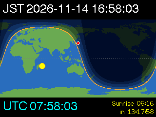

# m5-grayline

English | [日本語](README.ja.md)

A grayline map for M5Stack. It shows day, night, twilight and the grayline
(the sunrise / sunset terminator) on a world map, with the time synchronized
over Wi-Fi (NTP).

| Photo style (default) | Twilight zones | Grid + Moon overlay | Info screen |
| --- | --- | --- | --- |
|  |  |  |  |

## Features

- World map in equirectangular projection, centered on your longitude
- Two map styles: photo style (NASA Blue Marble / Earth at Night) and
  twilight zones (civil, nautical, astronomical)
- Grayline, subsolar point, home marker; optional Maidenhead grid and Moon
- Local time, UTC and a countdown to the next sunrise / sunset
  (polar night and midnight sun are handled)
- Info screen: twilight, sunrise / sunset and solar noon times, day length,
  sun altitude / azimuth, declination, equation of time, Moon phase, grid locator
- Home location from `config.json`, or from GeoIP (ipinfo.io), or Tokyo
- Auto-dimming at night or on battery; Wi-Fi is off between NTP syncs

Buttons: A = resync NTP, B = map style (long press: overlays), C = map / info screen.

## Supported hardware

- M5Stack Basic V2.6 (ESP32, 16 MB flash, no PSRAM)
- A microSD card for `config.json`

Other M5Stack models are not tested.

## Installing

A browser-based installer (Web Flasher) and a user manual are in preparation.
For now, use one of the following.

### From GitHub Releases

Download the firmware from [Releases](../../releases) and write it with
[esptool](https://github.com/espressif/esptool). Replace `<port>` with the
serial port of the device (e.g. `/dev/ttyUSB0`, `/dev/cu.usbserial-XXXX`, `COM3`).

```bash
esptool.py --chip esp32 --port <port> --baud 921600 write_flash 0x0 m5-grayline-vX.Y.Z-full.bin
```

`*-full.bin` is a full image written at `0x0`. `*-app.bin` is the application
only, written at `0x10000` to update a device that already runs m5-grayline.

### Building with PlatformIO

```bash
pio run -t upload
```

Unit tests of the calculation code run on the PC:

```bash
pio test -e native
```

See [docs/DEVELOPMENT.md](docs/DEVELOPMENT.md) (in Japanese) for serial commands,
tools, tests and the versioning policy.

## Configuration

Settings are read from `/grayline/config.json` on the microSD card. If the
file does not exist, the device creates one with default values; put the
card in your PC and fill in your Wi-Fi SSID and password.
See [config.example.json](config.example.json):

```json
{
  "version": 1,
  "wifi": { "ssid": "your-ssid", "password": "your-password" },
  "home": { "name": "Tokyo", "lat": 35.6895, "lon": 139.6917,
            "geoip": true, "ipinfo_token": "" },
  "map": { "center_lon": 139.6917 },
  "time": { "tz_label": "JST", "tz_offset_min": 540,
            "ntp": ["ntp.nict.jp", "time.google.com", "pool.ntp.org"],
            "ntp_interval_min": 360 },
  "display": { "brightness": 160, "dim_brightness": 16, "wake_sec": 30, "day_alt_deg": -6 }
}
```

The home location is chosen in this order:

1. `home.lat` and `home.lon` in `config.json`
2. GeoIP (ipinfo.io), looked up while Wi-Fi is on; the last result is kept on the device
3. Tokyo

`map.center_lon` is optional; without it, the map is centered on home.
`home.ipinfo_token` is optional; the free tier of ipinfo.io works without it.

### Privacy: GeoIP

When `home.lat` / `home.lon` are not set, the device sends a request to
ipinfo.io at boot and on each NTP sync, so **your global IP address is sent
to ipinfo.io**. If you set `home.lat` and `home.lon` (or `"geoip": false`),
no request is made to ipinfo.io.

## Data sources

- Day map: NASA Blue Marble (public domain)
- Night map: NASA Earth at Night (public domain)
- Land mask: [Natural Earth](https://www.naturalearthdata.com/) (public domain)
- GeoIP: [ipinfo.io](https://ipinfo.io/)

See [THIRD_PARTY_NOTICES.md](THIRD_PARTY_NOTICES.md) for details.

## License

[MIT](LICENSE). Third-party libraries and data are under their own licenses;
see [THIRD_PARTY_NOTICES.md](THIRD_PARTY_NOTICES.md).
