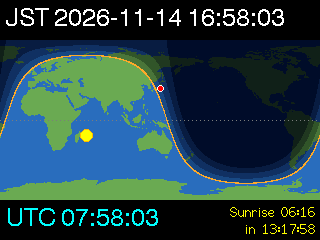
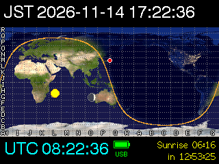

m5-grayline is a firmware for M5Stack Basic that shows a world map with day, night, twilight and the grayline (the sunrise / sunset terminator). The time is synchronized over Wi-Fi with NTP, and the map is redrawn every minute.

## Screens

Button B switches between two map styles. The first image below shows the twilight zones style, and the second shows the Maidenhead grid and Moon overlay.

Button C switches to the info screen with today's sunrise, sunset and more for your location.

## Features

- World map in equirectangular projection, centered on your longitude.
- Two map styles:
  - Photo style: NASA Blue Marble by day and NASA Earth at Night (city lights) by night, blended smoothly between sun altitudes of -12° and +2°.
  - Twilight zones: day, civil twilight (-6°), nautical twilight (-12°), astronomical twilight (-18°) and night in steps of brightness.
- Grayline, subsolar point and your location. Optional Maidenhead grid and Moon (sublunar point with its phase).
- Local time, UTC, and a countdown to your next sunrise or sunset. Polar night and midnight sun are handled.
- Info screen: today's twilight, sunrise, sunset and solar noon times, day length, current sun altitude and azimuth, declination, equation of time, Moon illumination and grid locator.
- Your location comes from the latitude / longitude in `config.json` on the microSD card, or an estimate by GeoIP (ipinfo.io), or Tokyo, in this order.
- The screen is dimmed at night and on battery. Wi-Fi is on only while synchronizing the time.

## What you need

- M5Stack Basic V2.6 (other models are not tested)
- A microSD card (for the settings file `config.json`)
- A 2.4 GHz Wi-Fi network (for the time)
- A computer and a USB Type-C cable for installing the firmware

## Next steps

1. Install the firmware: see [Installing the firmware](install/).
2. Set up Wi-Fi and your location: see [Configuration (config.json)](config/).
3. Learn the screens and buttons: see [Screens and buttons](usage/).
