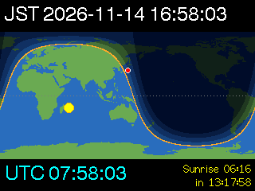

m5-grayline は、M5Stack Basic の画面に世界地図を表示し、その上に昼・夜・薄明とグレイライン (日の出・日の入りの境界線) を描くファームウェアです。時刻は Wi-Fi 経由の NTP で取得し、1 分ごとに地図を描き直します。

## 画面の例

地図はボタン B で 2 種類を切り替えられます。次の 1 枚目が薄明の塗り分け、2 枚目は Maidenhead グリッドと月を重ねて描いた例です。

ボタン C で、自局の日の出・日の入りなどをまとめた詳細画面に切り替わります。

## できること

- 正距円筒図法の世界地図を、自局の経度を中心に表示します。
- 地図の表示を 2 種類から選べます。
  - 写真風: 昼は NASA Blue Marble、夜は NASA Earth at Night (都市の明かり) を表示し、太陽高度 -12° から +2° の間でなめらかに合成します。
  - 薄明の塗り分け: 昼、市民薄明 (-6°)、航海薄明 (-12°)、天文薄明 (-18°)、夜を段階的な明るさで塗り分けます。
- グレイライン、太陽直下点、自局の位置を表示します。Maidenhead グリッドと月 (月直下点と満ち欠け) も重ねて表示できます。
- 現地時刻と UTC、自局の次の日の出または日の入りまでのカウントダウンを表示します。日の出・日の入りがない極夜・白夜にも対応します。
- 詳細画面に、本日の薄明・日の出・日の入り・南中の時刻、昼の長さ、現在の太陽の高度と方位、赤緯、均時差、月の輝面比、グリッドロケーターを表示します。
- 自局の位置は、microSD の `config.json` の緯度経度、GeoIP (ipinfo.io) による推定、東京の順に決めます。
- 夜間やバッテリー動作時は画面を暗くします。Wi-Fi は NTP 同期のときだけ接続します。

## 必要なもの

- M5Stack Basic V2.6 (ほかの機種では動作を確認していません)
- microSD カード (設定ファイル `config.json` を置きます)
- 2.4GHz 帯の Wi-Fi (時刻の取得に使います)
- 書き込みに使うパソコンと USB Type-C ケーブル

## 次に読むページ

1. [書き込み方法](install/) でファームウェアを書き込みます。
2. [設定 (config.json)](config/) で Wi-Fi と自局の位置を設定します。
3. [画面の見方と操作](usage/) で表示内容とボタンの操作を確認します。
