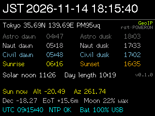

## ボタンの操作

本体の前面にある 3 つのボタンを、左から A、B、C と呼びます。

| ボタン | 操作 | 動作 |
| --- | --- | --- |
| A | 押す | NTP で時刻を再同期します。 |
| B | 押す | 地図の表示を "写真風" と "薄明の塗り分け" で切り替えます。 |
| B | 長押し (約 0.7 秒) | 重ね描きを "なし → Maidenhead グリッド → グリッドと月" の順に切り替えます。 |
| C | 押す | 地図画面と詳細画面を切り替えます。 |

地図の表示と重ね描きの選択は本体に記憶し、電源を切っても保持します。

画面が暗いときに押したボタンは、画面を一時的に明るくするだけで、操作としては扱いません。明るくなってから、もう一度押してください。

## 地図画面

### 上部

現地時刻を "タイムゾーン名 年-月-日 時:分:秒" の形で表示します。タイムゾーン名と時差は `config.json` の `time.tz_label` と `time.tz_offset_min` で設定します。

### 地図

正距円筒図法の世界地図です。中心の経度は、`map.center_lon` を設定していなければ自局の経度です。地図は 1 分ごとに描き直します。

| 表示 | 意味 |
| --- | --- |
| オレンジの線 | グレイライン (太陽高度 -0.833° の日の出・日の入りの線) |
| 黄色の円 | 太陽直下点 |
| 赤い点 | 自局の位置 |
| 灰色の点線 (横) | 赤道 |

地図の表示はボタン B で切り替えます。

- 写真風 (既定): 昼は NASA Blue Marble、夜は NASA Earth at Night (都市の明かり) を表示し、太陽高度 -12° から +2° の間でなめらかに合成します。
- 薄明の塗り分け: 昼、市民薄明 (太陽高度 0° から -6°)、航海薄明 (-6° から -12°)、天文薄明 (-12° から -18°)、夜を段階的な明るさで塗り分けます。

ボタン B の長押しで、次の重ね描きを切り替えます。

- Maidenhead グリッド: フィールド (経度 20°×緯度 10°) ごとに点線を引き、下端と左端にフィールドの文字を表示します。
- 月: 月直下点に、現在の満ち欠けの形で月を描きます。

### 下部

| 表示 | 意味 |
| --- | --- |
| `UTC 時:分:秒` | 協定世界時です。水色なら NTP で同期済み、赤なら未同期です。 |
| 電池アイコン | 電池の残量を 25% 刻みで表示します (25% 以下は赤)。枠が緑なら USB 給電中です。下の文字は、充電中なら `CHG`、USB 給電中なら `USB`、バッテリー動作中なら残量 (%) です。 |
| `Sunrise` / `Sunset` | 自局の次の日の出または日の入りの時刻 (現地時刻) と、それまでの残り時間です。 |
| `Polar night` / `Midnight sun` | 2 日以内に日の出・日の入りがない場合 (極夜・白夜) に表示します。下の行は現在の太陽高度です。 |

## 詳細画面

ボタン C で切り替えます。

| 行 | 内容 |
| --- | --- |
| 1 行目 | 自局の名前、緯度経度、グリッドロケーター (6 桁)。右上に位置の取得元 (`config`、`GeoIP`、`default`) と、直前の再起動の要因 (`rst:`) を表示します。 |
| 薄明・日の出・日の入り | 左が朝 (天文薄明の始まり、航海薄明の始まり、市民薄明の始まり、日の出)、右が夕方 (天文薄明の終わり、航海薄明の終わり、市民薄明の終わり、日の入り) の現地時刻です。その現象が起きない日は `--:--` と表示します。 |
| `Solar noon` / `Day length` | 南中時刻と昼の長さです。右端にファームウェアのバージョンを表示します。 |
| `Sun now` | 現在の太陽の高度 (`Alt`) と方位 (`Az`、北から時計回り) です。 |
| `Dec` / `EoT` / `Moon` | 太陽の赤緯 (度)、均時差 (分)、月の輝面比 (%) と満ち欠けの向き (`wax` は満ちていく途中、`wan` は欠けていく途中) です。 |
| 最下行 | UTC、NTP の同期状態 (`NTP OK` または `NO SYNC`)、電池の残量と給電状態です。 |

## 画面の明るさ

自局が昼 (太陽高度が `display.day_alt_deg` より高い) で、かつ USB 給電中のときは、画面を明るくします (`display.brightness`)。夜間やバッテリー動作中は暗くします (`display.dim_brightness`)。暗いときにボタンを押すと、`display.wake_sec` 秒の間だけ明るくなります。

## 時刻の同期

起動時に Wi-Fi に接続し、NTP で時刻を同期します。同期が終わると Wi-Fi を切断し、`time.ntp_interval_min` 分 (既定は 6 時間) ごとに再同期します。同期に失敗した場合は 30 分ごとに再試行します。ボタン A を押すと、すぐに再同期します。

一度も同期できていない間は、ファームウェアのビルド時刻を仮の時刻として使います。このとき、地図画面の UTC は赤で表示し、詳細画面には `NO SYNC` と表示します。
